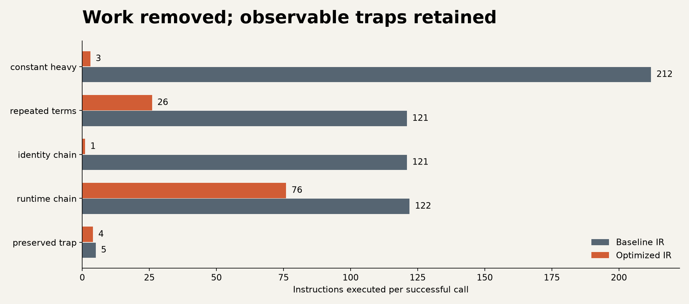

# Integer compiler optimization lab

**[View the report in your browser](https://Michaelhoang8.github.io/integer-compiler-lab/)**

A small integer language compiler with **observable-error preservation**, independent execution paths, differential tests and measured optimization tradeoffs.

The central problem: `let unused = x // divisor; return 0;` must still fail when `divisor` is zero. A dead-code pass that merely follows the returned value silently changes the language. This compiler keeps every potentially trapping operation live while eliminating safe redundant work.



## Inspect the project

| Artifact | What it shows |
|---|---|
| [Experiment report](docs/report.html) | Source-to-IR comparison, semantics, measurements and tradeoffs; download/open locally |
| [Screenshot gallery](docs/screenshots/README.md) | Rendered report sections for browser review without downloading the project |
| [Recorded walkthrough](docs/recordings/README.md) | Actual browser navigation through the report, with capture provenance |
| [Measured findings](results/findings.md) | Local timing results and an explicit interpretation of their limits |
| [Compiler source](src/integer_compiler/core.py) | Lexer, precedence parser, immutable AST/IR, tree interpreter, lowering, optimizer and VM |
| [Before/after IR](results/listings) | Every benchmark program's baseline and optimized register instructions |
| [Raw samples](results/raw_timings.csv) | 375 timed execution samples, 300 calls per sample |
| [Tests](tests) | Language contracts, failure preservation and differential execution |
| [Design notes](docs/design.md) | Language grammar, optimization invariants and deliberate exclusions |
| [Benchmark protocol](docs/benchmark-method.md) | Measurement procedure, denominators and reproduction instructions |

The checked-in run compares the same VM before and after optimization, alongside a separate tree interpreter. Synthetic constant-heavy and identity-heavy programs shrink sharply; the less optimizable runtime chain shows a much smaller effect. See the actual [results](results/findings.md) rather than treating the largest microbenchmark ratio as a general compiler speedup.

The 15-test suite includes **1,920 generated program/input cases** checked against an independent arithmetic oracle, as well as exception-order and published-result reconciliation checks.

## Run

Python 3.11+ is sufficient for the compiler and tests; the checked-in experiment used Python 3.13.17. Python 3.13 is recommended for the pinned plotting dependencies.

```sh
python -m venv .venv
# Windows PowerShell: .venv\Scripts\Activate.ps1
# macOS/Linux: source .venv/bin/activate
python -m pip install -e .
python -m integer_compiler examples/discount.int --inputs '{"price": 1499, "quantity": 3}' --ir
python -m unittest discover -s tests -v
```

PowerShell versions with legacy native-argument quoting may require escaping JSON's double quotes. The same example can be executed without shell quoting:

```python
from pathlib import Path
from integer_compiler import parse, compile_program, optimize, execute

program = parse(Path("examples/discount.int").read_text())
code = optimize(compile_program(program)).code
assert execute(code, {"price": 1499, "quantity": 3}) == 3822
```

Reproduce charts, IR listings and the HTML report:

```sh
python -m pip install -r requirements.txt
python scripts/run_experiments.py
```

This replaces `results/` and generated report/chart files with **new measurements from your machine**. To preserve the published run:

```sh
python scripts/run_experiments.py --output-dir build/my-run
```

CI runs the complete test suite and a smaller experiment under `build/ci`. Timing assertions deliberately avoid hardware-dependent speed thresholds.

## What is implemented

- A lexer and precedence-climbing parser, with duplicate/undefined-binding rejection.
- Immutable expression trees and single-assignment register IR; source expressions execute left to right.
- A tree interpreter independent of IR lowering, plus a baseline/optimized register VM.
- Constant folding, arithmetic identities, local value numbering and conservative dead-code elimination.
- Eager validation of all declared inputs, including inputs optimized out of the register stream.
- Real timing samples, compile-cost measurements, environment metadata and before/after artifacts.

## Scope and provenance

This is an **AI-assisted portfolio project** with synthetic programs and actual local measurements. It generates interpreted register IR, not native assembly or a JIT. It has no branches, loops, functions, I/O, pointers, floating point or fixed-width overflow. The runtime chain is a useful comparison, not a representative production workload. No business impact or employer result is claimed.

The parser and evaluators assume small educational inputs. They are not a sandbox for hostile programs: very deep expressions or huge integers can consume excessive resources. The compiler and runtime do not use `eval` or `exec`. The independent test oracle evaluates locally generated arithmetic expressions with Python to check the implementation.
